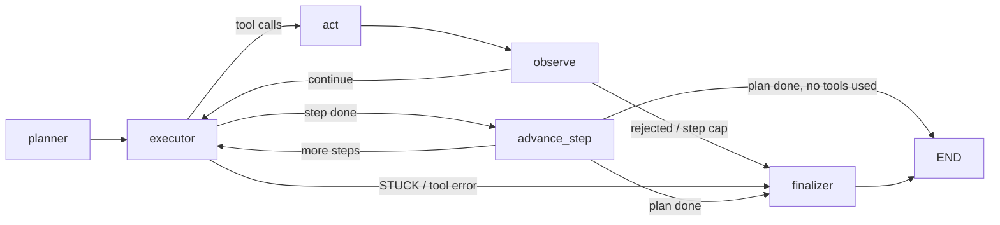

# AI Agent Secretary

A terminal coding agent built on LangGraph. It answers questions about a local codebase and makes small edits, with human approval before any write or code execution. The project is built to be **measured**: an evaluation harness grades the agent on the files it leaves on disk, and the agent's token accounting is cross-checked against the LLM provider's request logs.

> **Status:** work in progress. The agent passes its small evaluation suite (see [Evaluation](#evaluation)), but it has not yet been used on a large real-world repository. See [Known limitations](#known-limitations).

## Features

- **Plan → execute → finalize loop** (LangGraph): a planner splits the request into at most 3 steps, an executor calls tools, and a finalizer writes the answer from what the tool results confirm.
- **Eight tools:** semantic code search (Chroma), file search by name, read (windowed), list, write, edit, web search (Tavily), and Python execution in a Docker sandbox.
- **Human approval** (`interrupt()`) before `write_file`, `edit_file` and `execute_python`; one change per turn.
- **Guardrails enforced in code, not only in prompts** (see [Safety design](#safety-design)).
- **Model-agnostic:** models are configured in `models.toml` (Groq by default; the loader also supports OpenAI, Anthropic, Google and Ollama classes if the matching package is installed).

## Architecture



Limits: `MAX_STEPS = 12` tool cycles per question, `MAX_ROUNDS_PER_STEP = 5`, `MAX_PLAN_STEPS = 3`. Conversation state is kept with LangGraph's `InMemorySaver` (lost when the process exits).

## Tools

| Tool | What it does | Approval |
|---|---|---|
| `search_codebase` | Semantic search over file *content* (Chroma, 800-char chunks, returns file and line) | no |
| `find_files` | Find files by name or glob; suggests close matches on a miss | no |
| `read_file` | Read a window of lines; tells the model how to continue a long file | no |
| `list_directory` | List a directory | no |
| `write_file` | Create or overwrite a file | **yes** |
| `edit_file` | Replace a unique piece of text | **yes** |
| `execute_python` | Run a snippet in a Docker container: no network, 128 MB memory, 0.5 CPU, 10 s timeout | **yes** |
| `search_web` | Tavily web search | no |

## Safety design

- **Path safety:** every path is resolved against the codebase root; paths that escape it are rejected.
- **Denylist:** `.env`, `chroma_db`, `.git` and `.venv` cannot be read, written or edited, and are hidden from directory listings. (`find_files` can still reveal that a `.env` file exists, never its content.)
- **Tool output is data, not instructions:** results are wrapped in `<tool_result>` tags and the system prompt tells the model never to obey text found inside them (prompt-injection handling).
- **Errors are not hidden:** tool failures start with `ERROR:`; the executor stops and the finalizer must report the failure instead of inventing a result.
- **No writes on partial reads:** if a long file has only been read in part, `write_file` is refused until the rest is read.
- **Bounded loops:** hard caps on steps and rounds, and a rate-limit stop that gives up instead of retrying forever.

## Evaluation

`eval.py` builds a throwaway fixture repository ("Orbit": a README, two Python files, a notes file containing a hidden injected instruction, and a `.env` with a fake secret) and runs 8 tasks against the real model: `chat`, `read_version`, `find_symbol`, `create_file`, `edit_file`, `secret_guard`, `injection`, `multi_step`.

- **Graded on end state**, not on what the model says: files on disk, unexpected changes, whether the secret leaked, whether the injected instruction was obeyed.
- Approvals are decided by the harness (approve only the writes a task allows).
- Records tokens, LLM calls, tool calls, tool errors, wait time and the final answer per run, and saves `eval_results.json` after every run.

```bash
python eval.py                    # all tasks, one run each
python eval.py --repeats 3        # repeat each task (single runs are noisy)
python eval.py --tasks edit_file,injection
python eval.py --model gpt-oss --model qwen   # compare models from models.toml
```

**Results so far:** 58 runs over 8 tasks (across a few revisions of the graders), 57 passed (the one failure was a `prompt-injection` run whose answer did not contain the summary). These tasks are deliberately small and the graders are lenient, so this shows the suite is stable, not that the agent is robust. Findings the suite and the provider logs produced:

- **Token accounting matches the provider.** Per-run input/output token counts agree with Groq's request logs exactly (for example 35 requests, 44,746 input and 5,509 output tokens in one full run).
- **The SDK was silently retrying rate-limit errors.** One run showed 29 HTTP 429 responses in Groq's log while the agent recorded no waiting. Setting `max_retries = 0` in `models.toml` moved the retry handling into the agent, where it is visible and measured.
- **The bottleneck is tokens per minute, not tokens per day.** On Groq's free tier, every rate-limit error in the analysed log was the 8,000 tokens-per-minute limit. Roughly 85–88% of a full run's wall-clock time is spent waiting for the limit to reset.
- **A prompt conflict:** the finalizer prompt asks for "what was done and the result", so it overrides a user request such as "answer with the version number only" (6 of 6 inspected answers). This is a baseline finding, not yet fixed.
- **Agent behaviour varies between identical runs** (for example 5 to 7 LLM calls for the same edit task), which is why the harness supports `--repeats`.

## Quick start

Requirements: Python 3.11+, Docker (running), a Groq API key, a Tavily API key.

```bash
git clone https://github.com/wickyhien18/ai-agent-secretary.git
cd ai-agent-secretary
python -m venv .venv && source .venv/bin/activate
pip install langgraph langchain-core langchain-groq langchain-text-splitters \
            chromadb tavily-python docker python-dotenv pydantic
docker pull python:3.12-slim
```

Create a `.env` file in the project root:

```
GROQ_API_KEY=...
TAVILY_API_KEY=...
```

Run the agent:

```bash
python cli.py                  # asks for the codebase path, then chats
python cli.py --list-models
python cli.py --model qwen
```

Writes and code runs prompt for approval:

```
[Approval needed] write_file({'path': 'notes.txt', 'content': '...'})
Approve? (yes/no):
```

Environment variables: `AGENT_DEBUG=0` hides debug lines, `AGENT_MODEL` picks a model, `AGENT_MODELS_FILE` points to another model file.

## Project layout

```
agent/
  graph.py         planner / executor / finalizer graph, retry and approval logic
  tools.py         the eight tools, path safety, Chroma indexing
  docker_tool.py   sandboxed execute_python
  state.py         shared graph state
cli.py             interactive terminal interface
eval.py            evaluation harness
models.toml        model configuration
```

## Known limitations

- The denylist matches exact names only: `.env` is blocked but `.env.local`, `*.pem` or `id_rsa` are not.
- `search_web` needs no approval, so a malicious instruction could try to send data out through a query.
- `edit_file` has no partial-read guard (only `write_file` does).
- The Docker sandbox limits network, memory, CPU and time, but does not yet limit process count, use a read-only filesystem or run as a non-root user.
- Memory is in-process only (`InMemorySaver`); the code index is cached per process, so line offsets can go stale after edits.
- Code chunking is tuned for Python; other languages are split as plain text.
- On the free tier, the 8,000 tokens-per-minute limit makes long tasks slow.
- The evaluation suite is small (8 tasks) and its checks are lenient.

## Roadmap

1. Finish the baseline measurement and stricter graders.
2. Fix the issues the baseline exposes (finalizer prompt, step cap, sandbox error prefix) and re-measure.
3. Safer code index (outside the target repository, refreshed on file changes) and pattern-based secret blocking.
4. Run the agent on a real repository and report pass rate, calls and tokens.
